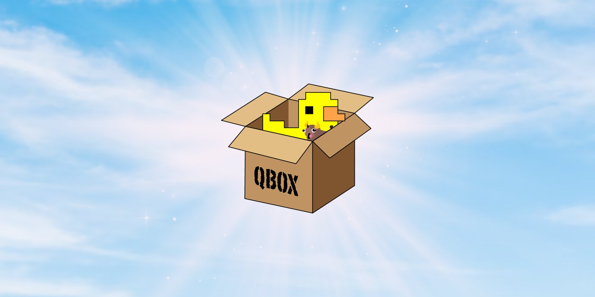

_
"And then there was Qbox"
_

# qbx_core

qbx_core is a framework created on September 27, 2022, as a successor to qb-core and continues the development of a solid foundation for building easy-to-use, performant, and secure server resources.

Want to know more? View our [documentation](https://qbox-project.github.io/)

# Features

- **Bridge layer provides Backwards compatibility with Most QB Resources with 0 effort required**
- Built-in multicharacter
- Built-in multi-job/gang
- Built-in queue system for full servers
- Persistent player vehicles
- Export based API to read/write core data

## Modules
The core makes available several optional modules for developers to import into their resources:
- Hooks: For developers to provide Ox style hooks to extend the functionality of their resources
- Logger: Can log to either discord, or Ox's logger through one interface
- Lib: Common functions for tables, strings, math, native audio, vehicles, and drawing text.

# Dependencies

- [oxmysql](https://github.com/overextended/oxmysql)
- [ox_lib](https://github.com/overextended/ox_lib)
- [ox_inventory](https://github.com/overextended/ox_inventory)

#

⚠️We advise not modifying the core outside of the config files⚠️

If you feel something is missing or want to suggest additional functionality that can be added to qbx_core, bring it up on the official [Qbox Discord](https://discord.gg/qbox)!

Thank you to everyone and their contributions (large or small!), as this wouldn't have been possible.

# License

    qbx_core
    Copyright (C) 2022-2026 Qbox Project contributors

    Based on QBCore Framework, forked on September 23, 2022
    Copyright (C) 2021-2022 QBCore Framework contributors

    This program is free software: you can redistribute it and/or modify
    it under the terms of the GNU General Public License as published by
    the Free Software Foundation, either version 3 of the License, or
    (at your option) any later version.

    This program is distributed in the hope that it will be useful,
    but WITHOUT ANY WARRANTY; without even the implied warranty of
    MERCHANTABILITY or FITNESS FOR A PARTICULAR PURPOSE.  See the
    GNU General Public License for more details.

    You should have received a copy of the GNU General Public License
    along with this program.  If not, see <https://www.gnu.org/licenses/>.

The full license text is in [LICENSE](LICENSE). Code adapted from other projects is marked where it appears with its source, copyright holder, and license. Code adapted from [ox_lib](https://github.com/overextended/ox_lib) is licensed under the LGPL-3.0-or-later, included in [LICENSES/LGPL-3.0-or-later.txt](LICENSES/LGPL-3.0-or-later.txt).
